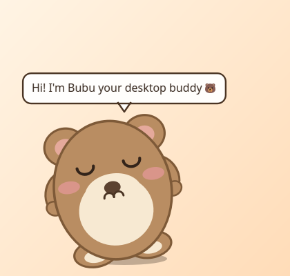

# 🐻 Bubu Desktop Buddy


A tiny open-source companion for your desktop. Bubu walks along your
taskbar, naps, dances, chats in speech bubbles and begs for snacks — and he's
drawn entirely in code, so the whole app is one small dependency-free Python
project you can read in an afternoon.

Works on Windows and Ubuntu/Linux (X11 and Wayland via XWayland).



## ✨ Features

- 🚶 **Lives on your taskbar** — wanders along the bottom of your screen, picks
  random spots, sits and chatters
- 🪂 **Real gravity** — drag him anywhere and drop him; he falls, bounces and
  walks back
- 💬 **Speech bubbles** — greetings, complaints about hunger, nap commentary
- 🥰 **Pettable** — click him for hearts and happy wiggles, double-click to make
  him jump
- 🍪 **Feedable** — right-click → *Feed a snack*; he actually eats the cookie
  down to crumbs
- 😴 **Needs simulation** — hunger and mood drift over time, so he'll ask for
  attention (can be turned off in Settings)
- ⚙️ **Settings** — size, speed, speech bubbles, always-on-top, start on login
- 🖥️ **Multi-monitor aware** — clamps to the screen and work area he's on
- 📦 **Single small binary** — one PyInstaller file, ~30 MB, no installer

## 🚀 Quick start (from source)

### Ubuntu / Linux

```bash
git clone https://github.com/your-name/bubu-desktop-buddy.git
cd bubu-desktop-buddy
python3 -m venv .venv
.venv/bin/pip install -r requirements.txt
.venv/bin/python -m bubu
```

Add Bubu to your application grid with a `.desktop` launcher:

```bash
./scripts/install-desktop.sh   # then search "Bubu Desktop Buddy"
```

Or build a standalone executable:

```bash
./scripts/build.sh
# → dist/BubuDesktopBuddy
```

### Windows

```powershell
git clone https://github.com/your-name/bubu-desktop-buddy.git
cd bubu-desktop-buddy
python -m pip install -r requirements.txt
python -m bubu
```

Or build the standalone executable:

```powershell
powershell -ExecutionPolicy Bypass -File scripts\build.ps1
# → dist\BubuDesktopBuddy.exe
```

## 🎮 Controls

| Action | Effect |
|--------|--------|
| **Click** Bubu | Pet him (+ hearts, + mood) |
| **Double-click** | Jump |
| **Drag & drop** | Pick him up, drop him anywhere — he falls and walks back |
| **Right-click** | Menu: feed, dance, nap, talk, settings, about, quit |

## ⚙️ Settings

Right-click Bubu → *Settings…*

- **Bubu size** — 60% to 140%
- **Walk speed** — slow / normal / fast
- **Speech bubbles** on or off
- **Needs** — hunger & mood simulation (off = relaxed Bubu)
- **Always on top** — keep him above your other windows
- **Start on login** — Windows: writes to your user's `Run` registry key;
  Linux: writes `~/.config/autostart/bubu-desktop-buddy.desktop`

Settings and his last position are saved to
`%APPDATA%\BubuDesktopBuddy\settings.json` on Windows or
`~/.config/BubuDesktopBuddy/settings.json` on Linux. Use
`python -m bubu --reset` to start fresh.

## 🧩 How it works

| File | Responsibility |
|------|----------------|
| `bubu/buddy.py` | Frameless translucent window: physics, walking, drag & drop, speech bubbles, particles |
| `bubu/character.py` | Bubu's body — ears, squash & stretch, blinking, moods — drawn with QPainter primitives |
| `bubu/brain.py` | Tiny state machine: walk → idle → dance → nap, reacts to hunger |
| `bubu/stats.py` | Hunger/mood decay rates |
| `bubu/lines.py` | Every phrase Bubu can say (add your own!) |
| `tools/generate_icon.py` | Rasterises the app icon with the standard library only |

Bubu never blocks your clicks: his window only covers the pixels he occupies,
and it follows him around the screen 60 times per second.

## 🧪 Development

```bash
python -m bubu --smoke-test     # starts the app, pets/feeds/jumps/dances, exits 0
python tools/generate_icon.py   # regenerate assets/icon.{png,ico}
python tools/make_screenshot.py # regenerate docs/screenshot.png (works headless)
```

See [CONTRIBUTING.md](CONTRIBUTING.md) for ideas and guidelines.

## 📄 License

[MIT](LICENSE) — free to use, modify and share. Bubu's artwork is original and
generated by code in this repository, so there is nothing to license apart from
this code itself.
